<h3><code>malta@github ~ $ whoami</code></h3>
<table>
<tr>
<td valign="top"></td>
<td valign="top"></td>
</tr>
</table>

 

<h3><code>malta@github ~ $ ./habilidades.sh --scan</code></h3>

  

<h3><code>malta@github ~ $ ./contribuicoes.sh</code></h3>

